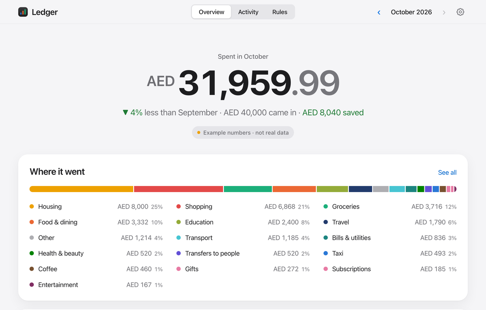

#  Hi there!

Hey, I'm Aisan, a **technical product manager** for AI and data products. I went from math to design to product, and I still like building: OKRs and roadmaps on one side, SQL, BI dashboards and working prototypes on the other. I'm now doing an **MSc in Artificial Intelligence** at Heriot-Watt University in Dubai, and I build my side projects with Claude Code.

**How I work**

I start with the problem, write it down, then build. The projects below come with the docs I'd write at work: a PRD or a clear "why", a decision log or design notes, and tests that run in CI.

**Website**

##  Featured Projects

### [Ledger](https://github.com/amojahedi/inbox-ledger)

<a href="https://github.com/amojahedi/inbox-ledger">
  <picture>
    <source media="(prefers-color-scheme: dark)" srcset="assets/ledger-overview-dark.png">
    
  </picture>
</a>

Your bank already emails you every transaction. Ledger turns those alerts into a **private monthly budget on your own machine**: read-only Gmail, one small YAML profile per bank (UAE banks built in, no code to add a new one), no double counting of transfers between your own accounts, pay-later charges matched to the real store, and rules it learns from a single correction. Optional AI runs on your own Claude key and shows exactly what it will send first.

- **Product thinking:** [Why it exists](https://github.com/amojahedi/inbox-ledger#why) · [How it works](https://github.com/amojahedi/inbox-ledger#how-it-works) · [Privacy](https://github.com/amojahedi/inbox-ledger#privacy)
- **Built with:** Python, FastAPI, SQLite, vanilla JS with hand-drawn SVG charts

### [Growloop](https://github.com/amojahedi/growloop)

A growth loop for yourself: plan, learn, reflect, repeat. Growloop is a **local-first self-development planner for product people**: yearly growth OKRs tied to skills, gold-standard learning resources, a kanban board, a notebook and a progress dashboard. AI help runs on your own Claude Code, and your data stays on your machine.

- **Product thinking:** [PRD](https://github.com/amojahedi/growloop/blob/main/docs/PRD.md) · [Decision log](https://github.com/amojahedi/growloop/blob/main/docs/decisions/README.md)
- **Built with:** Next.js, TypeScript, React, Tailwind CSS
<!-- TODO: add "· [Live demo](<DEMO_URL>)" once the demo is deployed, and optionally a screenshot/GIF here. -->

<!-- OPTIONAL: uncomment to feature the team ML project once it's finished (confirm you're comfortable showing it)
### [Predicting Chronic Kidney Disease](https://github.com/elgazar24/F21DL_Group_13)

A team machine-learning project that compares classic models with an MLP to predict five CKD risk levels from clinical and lab data.
-->

##  Experience

&nbsp;**Product Advisor**, United Future · *2024 – 2026*: advised the founders on the analytics roadmap, helped replace manual reporting with one BI platform, and wrote requirements for a KPI dashboard (revenue, churn, fraud).

&nbsp;**Data Product Manager**, Asa (Agah Group) · *2023 – 2024*: worked on Investor360 (client investment volume up 12%) and helped merge 6 siloed pods into one team of 30 engineers.

&nbsp;**Product Manager**, Digikala / Digipay · *2022 – 2023*: wrote requirements to move Digikala's finance platform to Go, and worked with the Digipay BI team to get reports in 1 week instead of 3 months.

&nbsp;**Associate Product Manager**, In-House (New York, remote) · *2021 – 2022*: helped build the design system and UX fixes; our A/B-tested prototypes lifted beta engagement by about 25%.

&nbsp;**Co-founder & Product Designer**, Avistopia · *2019 – 2021*: designed a gamified math and computer science learning platform; we launched with three engineers and reached 3,000+ early users.

**Education**

&nbsp;MSc Artificial Intelligence, Heriot-Watt University Dubai · *2026 – present* · merit scholarship

&nbsp;MSc Computer Science (coursework), Shahid Beheshti University · *2022 – 2023*

&nbsp;BSc Applied Mathematics, University of Tehran · *2017 – 2022*

##  My Toolkit

**Frameworks I use**

**Product & Delivery**

**Data & Analytics**

**Automation & AI**

**Build**

##  Certifications

[-Product%20School-5B3DF5?style=for-the-badge)](https://www.linkedin.com/in/aisan-mojahedi/details/certifications/)

##  Find Me Elsewhere

Open to Product Manager roles in the UAE and to relocation.

